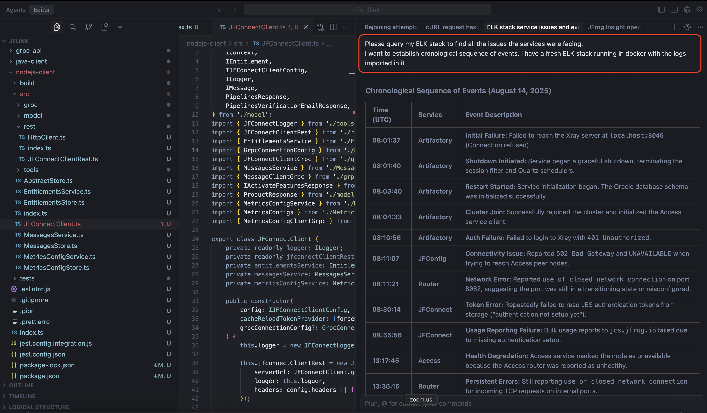

# JFrog Support Bundle Analyzer & MCP


A generic, automatic log ingestion tool for JFrog support bundles using Elasticsearch and Kibana. This tool automatically discovers services, parses various log formats, and indexes data for further analysis inside your local ELK stack.
This readme also includes an MCP server which can help you to query and analyze the data stored in the stack for your debugging and analysis.

## 🚀 Features

- **Automatic Service Discovery**: Discovers all microservices without manual configuration
- **Generic Log Parsing**: Handles multiple log formats automatically
- **Snake Case Conversion**: Automatically normalizes field names
- **Dynamic Elasticsearch Mappings**: No predefined schemas needed
- **Docker ELK Stack**: Easy setup with Docker Compose
- **Real-time Analysis**: Data available immediately in Kibana

## 📋 Prerequisites

- Node.js 16+ 
- Docker and Docker Compose
- 4GB+ RAM (for Elasticsearch)

## 🛠️ Installation

1. **Clone or download the project**
```bash
git clone <repository-url>
cd support-bundle-analyzer
```

2. **Install dependencies**
```bash
npm install
```

3. **Start Elasticsearch and Kibana**
```bash
npm run docker:up
```

4. **Wait for services to be ready** (about 30-60 seconds)
```bash
# Check Elasticsearch
curl http://localhost:9200

# Check Kibana
curl http://localhost:5601
```

## 🎯 Usage

### Basic Usage
```bash
# Analyze support bundle
npm start -- --bundle-path ./newlogs3

# Or with custom Elasticsearch URL
npm start -- --bundle-path ./newlogs3 --elasticsearch-url http://localhost:9200
```

### Advanced Options
```bash
# Verbose logging
npm start -- --bundle-path ./newlogs3 --verbose

# Dry run (no indexing)
npm start -- --bundle-path ./newlogs3 --dry-run

# Help
npm start -- --help
```

### Command Line Options
- `--bundle-path, -p`: Path to support bundle directory (required)
- `--elasticsearch-url, -e`: Elasticsearch URL (default: http://localhost:9200)
- `--verbose, -v`: Enable verbose logging
- `--dry-run, -d`: Perform dry run without indexing
- `--help, -h`: Show help

## 📊 Kibana Setup

After running the analyzer:

1. **Open Kibana**: http://localhost:5601

2. **Create Index Patterns**:
   - Go to **Stack Management** → **Index Patterns**
   - Create patterns for:
     - `support-bundle-*-requests`
     - `support-bundle-*-service`
     - `support-bundle-*-audit`
     - `support-bundle-*-access`
     - `support-bundle-*-system`
     - `support-bundle-*-thread_dumps`
     - `support-bundle-*-manifests`

3. **Explore Data**:
   - Go to **Discover** to explore your data
   - Use filters to narrow down by service, log type, etc.

## 🏗️ Architecture

```
Support Bundle Files → Node.js Parser → Elasticsearch → Kibana
```

### Components

- **Analyzer**: Auto-discovers services and processes logs
- **Log Parser**: Generic parser for multiple log formats
- **Elasticsearch Client**: Handles indexing with dynamic mappings
- **Utils**: Field normalization and data sanitization

### Supported Log Types

- **Request Logs**: API requests with timestamps, methods, paths, status codes
- **Service Logs**: Application logs with levels, classes, threads
- **Audit Logs**: Security events, token management
- **Access Logs**: Authentication and authorization events
- **System Info**: JVM metrics, host information
- **Thread Dumps**: Performance analysis data

## 📂 Source Code Overview

The `src` directory contains the core logic of the application. These scripts are internal modules used by the main entry point (`index.js`). You typically won't run these directly, but understanding them is useful for debugging or extending functionality.

### 1. `src/analyzer.js`
- **What it does**: The main engine of the application. It orchestrates the entire analysis process:
  - Discovers services within the support bundle.
  - Iterates through logs, system info, and thread dumps.
  - Uses `LogParser` to parse data and `ElasticsearchClient` to index it.
- **When to use**:
  - **Debugging**: If services are not being discovered correctly or if the overall flow fails.
  - **Extending**: If you need to add support for a new type of data folder (e.g., besides `logs` or `system`).

### 2. `src/log-parser.js`
- **What it does**: Contains the logic for parsing raw log lines into structured JSON objects. It supports multiple formats (requests, service, audit, etc.) and attempts to auto-detect the format.
- **When to use**:
  - **Debugging**: If specific log lines are failing to parse or are being parsed incorrectly.
  - **Extending**: If you encounter a new log format that isn't currently supported. You would add a new parser method here.

### 3. `src/elasticsearch-client.js`
- **What it does**: Manages the connection to Elasticsearch. It handles:
  - Creating index templates and lifecycle policies.
  - Bulk indexing documents for performance.
  - Managing index creation and deletion.
- **When to use**:
  - **Debugging**: If there are connection issues or indexing errors.
  - **Extending**: If you need to change index settings, mappings, or retention policies.

### 4. `src/utils.js`
- **What it does**: Provides helper functions used across the application, such as:
  - String manipulation (snake_case conversion).
  - Timestamp parsing and normalization.
  - Value sanitization.
- **When to use**:
  - **Debugging**: If field names are being malformed or timestamps are incorrect.
  - **Extending**: If you need new common utility functions for data processing.

## 🔧 Configuration

### Elasticsearch Settings
The tool creates dynamic index templates with:
- Automatic field mapping
- Data retention policies (30 days)
- Optimized settings for log data

### Field Normalization
All field names are automatically converted to snake_case:
- `requestId` → `request_id`
- `clientIP` → `client_ip`
- `userAgent` → `user_agent`

## 📈 Performance

- **Bulk Indexing**: Documents are indexed in batches for efficiency
- **Dynamic Mappings**: No predefined schemas required
- **Memory Efficient**: Processes files incrementally
- **Error Handling**: Continues processing even if individual files fail

## 🐳 Docker Commands

```bash
# Start services
npm run docker:up

# Stop services
npm run docker:down

# View logs
npm run docker:logs

# Check service status
docker-compose ps
```
Add MCP server to your faviourate IDE
```
{
  "mcpServers": {
    "elasticsearch-mcp-server": {
      "command": "docker",
      "args": [
        "run",
        "-i",
        "--rm",
        "-e",
        "ES_URL",
        "-e",
        "ES_API_KEY",
        "docker.elastic.co/mcp/elasticsearch",
        "stdio"
      ],
      "env": {
        "ES_URL": "http://localhost:9200",
        "ES_API_KEY": ""
      }
    }
  }
}
```


## 🔍 Troubleshooting

### Common Issues

1. **Elasticsearch Connection Failed**
   ```bash
   # Check if Elasticsearch is running
   curl http://localhost:9200
   
   # Restart services
   npm run docker:down
   npm run docker:up
   ```

2. **No Data in Kibana**
   - Wait for indexing to complete
   - Refresh indices: `curl -X POST http://localhost:9200/_refresh`
   - Check index patterns in Kibana

3. **Memory Issues**
   - Increase Docker memory limit
   - Reduce Elasticsearch heap size in docker-compose.yml

### Logs and Debugging

```bash
# Enable verbose logging
npm start -- --bundle-path ./newlogs3 --verbose

# Check Elasticsearch logs
docker-compose logs elasticsearch

# Check Kibana logs
docker-compose logs kibana
```

## 📝 Example Output

```
🚀 JFrog Support Bundle Analyzer
=====================================
📁 Bundle path: ./newlogs3
🔗 Elasticsearch: http://localhost:9200
🔍 Verbose mode: OFF
🧪 Dry run: OFF

✅ Bundle path validation passed
✅ Connected to Elasticsearch
✅ Dynamic index template created
✅ Index lifecycle policy created

📦 Processing bundle: gateway-1755178820823
🔍 Discovered 12 services: artifactory, access, event, evidence, frontend, jfconfig, jfconnect, metadata, observability, onemodelregistry, router, topology

🔧 Processing service: artifactory
📄 Processing log: artifactory-request.log
📊 Indexed 23262 documents to requests
📄 Processing log: artifactory-service.log
📊 Indexed 8235 documents to service

...

📊 Analysis Summary
==================
⏱️  Duration: 45.32 seconds
📦 Bundle ID: gateway-1755178820823
🔧 Services: 12
📄 Log files: 47
📝 Documents: 125,847
❌ Errors: 0
📁 Files processed: 47

🌐 Data is now available in Kibana at: http://localhost:5601
```

## 🤝 Contributing

1. Fork the repository
2. Create a feature branch
3. Make your changes
4. Add tests if applicable
5. Submit a pull request

## 📄 License

MIT License - see LICENSE file for details

## 🆘 Support

For issues and questions:
1. Check the troubleshooting section
2. Enable verbose logging for debugging
3. Create an issue with logs and error details
## 📚 Extending Log Types

The tool currently supports the following log types:

- **Request Logs** – API requests with timestamps, methods, paths, status codes  
- **Service Logs** – Application logs with levels, classes, threads  
- **Audit Logs** – Security events, token management  
- **Access Logs** – Authentication and authorization events  
- **System Info** – JVM metrics, host information  
- **Thread Dumps** – Performance analysis data  

### How to add support for a new log type

1. **Decide on a name** for the new type (e.g., `metrics`).
2. **Add a parser method** in `src/log-parser.js` and register it in the `parsers` map.
3. **Extend `detectLogType()`** in `src/analyzer.js` to return the new type for matching files/lines.
4. (Optional) **Add helper functions** to `src/utils.js` if needed.
5. **Update the README** – add a bullet describing the new log type.
6. **Write tests** for the new parser and run the tool to verify the new documents appear in Elasticsearch.

After these steps the analyzer will automatically discover, parse, and index the new log format alongside the existing ones.
